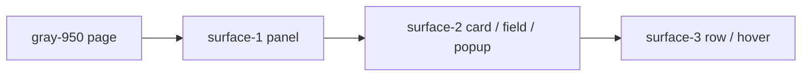
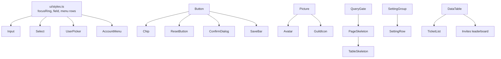
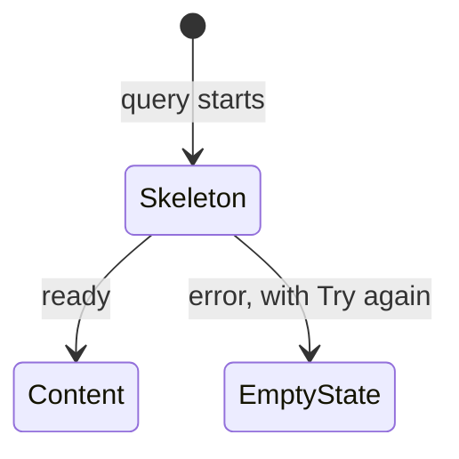
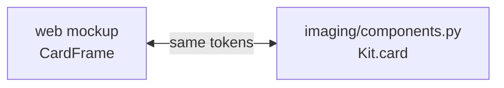

# Square design guide

How the dashboard, the landing page and the bot's image cards look. The code is the source of truth: shared classes live in [`ui/styles.ts`](apps/web/src/lib/components/ui/styles.ts), tokens in [`layout.css`](apps/web/src/routes/layout.css), card drawing in [`imaging/`](apps/bot/src/square/imaging).

## Rules

- Dark only. No light theme.
- Tailwind tokens only, and `gray` is the only grey. Its values are pinned to the hexes tailwindcss.com copies, so the bot's images match the site exactly. The accent is the one custom color.
- Even steps for size and spacing (`p-2`, `gap-4`, `h-8`). `px-3` on icon chips is the one exception.
- No borders on buttons, cards or popups. Depth comes from surfaces and shadows.
- Icons are Material Symbols, filled rounded only.
- One component per job. If two places draw the same thing, it belongs in `lib/components`.

## Color

| Token       | Value                               | Used for                                            |
| ----------- | ----------------------------------- | --------------------------------------------------- |
| page        | `gray-950` `#030712`                | Page and the dashboard frame                        |
| `surface-1` | `gray-900` `#111827`                | Panels, cards, drawers, dashboard shell             |
| `surface-2` | `gray-800` `#1F2937`                | Cards on a panel, secondary buttons, fields, popups |
| `surface-3` | `gray-700` `#374151`                | Rows in cards, hover on `surface-2`                 |
| `accent`    | `#1FCEEC`                           | Primary buttons, focus, checked state, links        |
| text        | `gray-100` / `gray-400`             | Body / secondary                                    |
| status      | `emerald-400` `amber-400` `red-400` | Success, warning, danger (fills at `/10`)           |
| `dc-*`      | Discord's dark theme                | Only inside things drawn to look like Discord       |

Each layer sits a step lighter than the one under it, so a control is always lighter than what it sits on.

## Type

| Role                   | Font           | Class          |
| ---------------------- | -------------- | -------------- |
| Headings               | Saira          | `font-display` |
| Body                   | Geist          | `font-sans`    |
| Numbers, counts, times | JetBrains Mono | `font-mono`    |
| Emoji                  | Twemoji first  | in every stack |

Page title `text-3xl`, section `text-xl`, group `text-lg`, body `text-sm`, captions `text-xs`, table headers `text-2xs` uppercase mono.

## Sizes

Phones get the next step up so every target stays at least 32px.

| Control                           | Desktop                                                         | Phone | Icon     |
| --------------------------------- | --------------------------------------------------------------- | ----- | -------- |
| Button `lg`                       | h-12                                                            | h-12  | 20       |
| Button `md` (default)             | h-10                                                            | h-12  | 16       |
| Button `sm`                       | h-8                                                             | h-10  | 16       |
| Button `xs`                       | h-6                                                             | h-8   | 12       |
| Icon button `md`                  | 40                                                              | 48    | 20       |
| Field (Input, Select, UserPicker) | h-10                                                            | h-12  | 16       |
| Toggle                            | 32 × 64, 4px padding, 24 × 32 pill that stretches while pressed | same  |          |
| Checkbox                          | 24                                                              | same  | 20       |
| Chip `md` / `sm`                  | h-8 / h-5                                                       | same  | 16 / 12  |
| Tab                               | h-12                                                            | same  | 16       |
| Menu row / sheet row              | h-10 / h-12                                                     |       | 16 to 20 |
| Setting row icon tile             | 40                                                              | same  | 20       |

Select markers (channel `#`, role color dot) fill the same 16px box as button icons.

## Radius

| Radius             | What                                         |
| ------------------ | -------------------------------------------- |
| `rounded-full`     | Buttons, fields, chips, toggles, header pill |
| `rounded-4xl`      | Big panels, dialogs, the dashboard frame     |
| `rounded-3xl`      | Cards, setting groups, tables, popovers      |
| `rounded-2xl`      | Rows, tiles, menu panels, art                |
| `rounded-xl`       | Menu items, icon tiles                       |
| `rounded-t-[28px]` | Drawers                                      |
| none               | Bot image cards (Discord rounds them)        |

## Focus and states

- Focus ring: `outline-2 outline-offset-2 outline-accent` (`focusRing`). Fields use a 2px inset ring instead, so focus never grows them.
- Disabled: `opacity-50`, with the reason in a Tooltip. Never a note line that shifts the layout.
- Busy: `Button loading` shows a spinner and keeps full opacity. Anything waiting on the bot uses it.
- Invalid field: `red-400/10` fill and a red ring.
- Any scroll box holding focusable things keeps at least 4px of room at its edges, or rings get clipped.

## Components

| Need                                  | Use                                                                                                                                                                                |
| ------------------------------------- | ---------------------------------------------------------------------------------------------------------------------------------------------------------------------------------- |
| Pick people                           | `UserPicker` (popup field on desktop, drawer on phones). Always the same one                                                                                                       |
| Pick channels or roles                | `Select`                                                                                                                                                                           |
| A group of settings                   | `SettingGroup` + `SettingRow` (`side`, `inline` or `below`)                                                                                                                        |
| A list of records                     | `DataTable`, rows open the details panel                                                                                                                                           |
| Ask before something destructive      | `ConfirmDialog` or `ResetButton`                                                                                                                                                   |
| A person                              | `PersonRow` or `Avatar` + name. Never "@name" text                                                                                                                                 |
| A channel, role or user in text       | `discord/Mention`                                                                                                                                                                  |
| Label + value                         | `Fact`                                                                                                                                                                             |
| Nothing to show, or it failed to load | `EmptyState`, centered where the content goes. `tone="danger"` + `retry` for errors, `card` when the spot has no box, `compact` in charts, panels and menus. Never a bare red line |
| Icon-only control                     | wrap it in `Tooltip`. No `title`, no `aria-label` for hints                                                                                                                        |
| A row of chips                        | `ScrollRow`, one line that scrolls                                                                                                                                                 |

## Loading

- Every loading state is a skeleton shaped like the content it replaces, using the `skeleton` utility (`animate-pulse bg-white/5`).
- Pages behind `QueryGate` pass their own `PageSkeleton` (tabs, setting groups, or a table with its toolbar), so nothing jumps when data lands.
- Lists that refresh in place show `TableSkeleton`. Pictures pulse until they load.
- The full-screen loader only runs on first boot and on navigations slower than 400ms. It's the static logo over the player's wave, flowing in CSS so it moves before the page hydrates.

## Motion

| What          | How                                                                     |
| ------------- | ----------------------------------------------------------------------- |
| Page change   | One fade, `animate-page-in` 300ms. No per-section entrances             |
| Press         | Ripple from the pointer                                                 |
| Popups, menus | `pop-in` spring 400ms, `pop-out` 150ms                                  |
| Details panel | `panel-in` 200ms, closes instantly                                      |
| Save bar      | `fade-in` 200ms / `fade-out` 150ms, the page moves with it, never after |
| List rows     | Slide with height collapse. Never `animate:flip`                        |
| Fields focus  | 200ms ease-out, no overshoot                                            |

Springs are `--ease-spring` (small bounce) and `--ease-smooth` (none). Reduced motion turns ripples off. No View Transitions API.

## Layout

- Desktop: left sidebar, content frame, details panel on the right (280px to 45vw). Phones: bottom nav, drawers for everything that's a popup on desktop.
- Dashboard content runs full width. Shell padding `px-4 py-6 md:px-8`, page gap `gap-6`.
- Stats and charts go on Overview only, drawn with LayerChart.
- Never switch tabs for the user. Pick once on load, then the tab is theirs.

## Bot image cards

The bot draws the same cards as the website mockups (`discord/CardFrame`, `InviteCard`, `NowPlayingCard`). Both sides share surfaces, chip size (h-8, 16px icons), radii and the wave progress bar.

Any visual change to a card goes into both, then gets checked side by side. Discord's own green, red and orange stay on things shown inside Discord.
