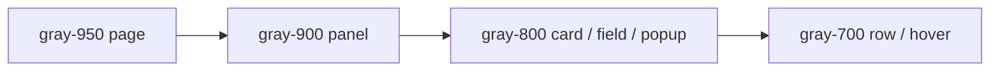
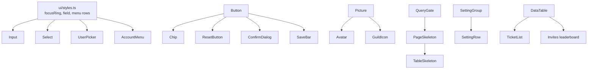
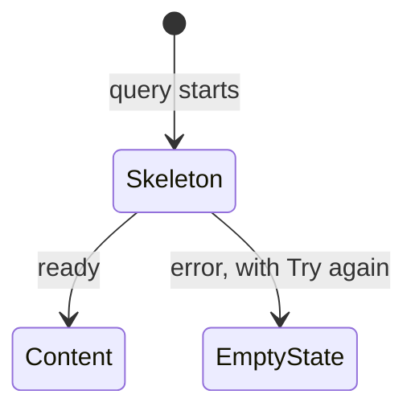
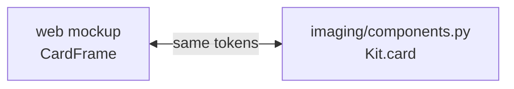

# Square design guide

How the dashboard, the landing page and the bot's image cards look. The code is the source of truth: shared classes live in [`ui/styles.ts`](apps/web/src/lib/components/ui/styles.ts), tokens in [`layout.css`](apps/web/src/routes/layout.css), card drawing in [`imaging/`](apps/bot/src/square/imaging).

## Rules

- Dark only. No light theme.
- Tailwind tokens only, and `gray` is the only grey. Tailwind's own values are used as they are. The bot's `theme.py` holds the sRGB colors the browser renders for them, so the images match the site exactly. The accent is the one custom color.
- Even steps for size and spacing (`p-2`, `gap-4`, `h-8`). `px-3` on icon chips is the one exception.
- No borders on buttons, cards or popups. Depth comes from surfaces and shadows.
- Icons are Material Symbols, filled rounded only.
- One component per job. If two places draw the same thing, it belongs in `lib/components`.

## Color

| Class                   | Value                               | Used for                                            |
| ----------------------- | ----------------------------------- | --------------------------------------------------- |
| `gray-950`              | `#030712`                           | Page, the dashboard frame and bot image cards       |
| `gray-900`              | `#101828`                           | Panels, cards, drawers, dashboard shell             |
| `gray-800`              | `#1E2939`                           | Cards on a panel, secondary buttons, fields, popups |
| `gray-700`              | `#364153`                           | Rows in cards, hover on `gray-800`                  |
| `accent`                | `#1FCEEC`                           | Primary buttons, focus, checked state, links        |
| `gray-100` / `gray-400` | text                                | Body / secondary                                    |
| status                  | `emerald-400` `amber-400` `red-400` | Success, warning, danger (fills at `/10`)           |
| `dc-*`                  | Discord's dark theme                | Only inside things drawn to look like Discord       |

Each layer sits a step lighter than the one under it, so a control is always lighter than what it sits on.

## Type

| Role                   | Font           | Class          |
| ---------------------- | -------------- | -------------- |
| Headings               | Saira          | `font-display` |
| Body                   | Noto Sans      | `font-sans`    |
| Numbers, counts, times | JetBrains Mono | `font-mono`    |
| Emoji                  | Twemoji first  | in every stack |

Page title `text-3xl`, section `text-xl`, group `text-lg`, body `text-sm`, captions `text-xs`, table headers `text-2xs` uppercase mono.

## Sizes

Phones get the next step up, so the default button and fields are 48px there. The radius is 0.4× the height and icons are about 1.4× the text.

| Control                           | Desktop                                                                               | Phone                      | Icon (desktop / phone) |
| --------------------------------- | ------------------------------------------------------------------------------------- | -------------------------- | ---------------------- |
| Button `lg`                       | h-12, radius 20, px 16, text 16                                                       | h-14, radius 24            | 24                     |
| Button `md` (default)             | h-10, radius 16, px 12, text 14                                                       | h-12, radius 20, px 16, 15 | 20 / 22                |
| Button `sm`                       | h-8, radius 12, px 12, text 13                                                        | h-10, radius 16, text 14   | 18 / 20                |
| Button `xs`                       | h-6, radius 8, px 8, text 12                                                          | h-8, radius 12, px 12, 13  | 16 / 18                |
| Field (Input, Select, UserPicker) | h-10, radius 16, px 12                                                                | h-12, radius 20, px 16     | 20                     |
| Toggle                            | 32 × 64 track radius 16, 24 × 32 thumb radius 12 (the one exception: half the height) | same                       |                        |
| Checkbox                          | 24, radius 8                                                                          | same                       | 20                     |
| Chip `md` / `sm`                  | h-8 radius 12 / h-5 radius 8                                                          | same                       | 16 / 12                |
| Tab                               | h-10                                                                                  | h-12                       | 20                     |
| Menu row / sheet row              | h-10 radius 16 / h-12 radius 20                                                       |                            | 20                     |
| Setting row icon tile             | 40                                                                                    | same                       | 20                     |

Select markers (channel `#`, role color dot) fill the same 20px box as menu icons. Padding is symmetric on both sides, with or without an icon.

## Shape

Every corner is a soft squircle: `corner-shape: superellipse(1.2)` set once in `layout.css` (`--corner`). Browsers without `corner-shape` draw the same radii as plain arcs. The bot draws the same curve in `imaging/canvas.py` (`CORNER_SHAPE`).

| Radius               | Value | What                                                           |
| -------------------- | ----- | -------------------------------------------------------------- |
| `rounded-lg`         | 8     | Thumbnails, small art, `xs` controls                           |
| `rounded-xl`         | 12    | Chips, `sm` controls, 32px icon buttons                        |
| `rounded-2xl`        | 16    | Buttons, fields, tiles, menu rows                              |
| `rounded-control-lg` | 20    | 48px controls and rows (phone buttons, `lg` buttons)           |
| `rounded-3xl`        | 24    | Popovers, menus, big art, 56px controls                        |
| `rounded-card`       | 28    | Cards, setting groups, tables, dialogs, the dashboard frame    |
| `rounded-t-sheet`    | 36    | Drawers                                                        |
| `rounded-icon`       | 40%   | Avatars and other square pictures, on the web and in bot cards |
| `rounded-full`       | round | Only status dots, slider thumbs and thin bars (true circles)   |
| none                 |       | Bot image cards (Discord rounds them)                          |

Nested shapes are concentric: inner radius = outer radius minus the padding between them. A card (28) with 12px padding holds tiles at 16, and a popover (24) with 8px padding holds rows at 16.

Discord mockups follow our shape only on their outer frame (`data-discord` root, `rounded-card`). Everything inside keeps Discord's round corners, including avatars (`<Avatar round>`). Discord pieces that live outside a frame (`Mention` in dashboard text, `DiscordTooltip`) opt out with `[corner-shape:round]`. The bot's image cards inside them (`CardFrame`, `data-card`) switch back to the squircle.

## Focus and states

- Focus ring: `outline-2 outline-offset-2 outline-accent` (`focusRing`). Fields use a 2px inset ring instead, so focus never grows them.
- Disabled: `opacity-50`, with the reason in a Tooltip. Never a note line that shifts the layout.
- Busy: `Button loading` shows a spinner and keeps full opacity. Anything waiting on the bot uses it.
- Invalid field: `red-400/10` fill and a red ring.
- Any scroll box holding focusable things keeps at least 4px of room at its edges, or rings get clipped.

## Components

| Need                                  | Use                                                                                                                                                                                |
| ------------------------------------- | ---------------------------------------------------------------------------------------------------------------------------------------------------------------------------------- |
| Pick people                           | `UserPicker` (popup field on desktop, drawer on phones). Always the same one                                                                                                       |
| Pick channels or roles                | `Select`                                                                                                                                                                           |
| A group of settings                   | `SettingGroup` + `SettingRow` (`side`, `inline` or `below`). `side` stacks when the group is under 672px wide                                                                      |
| An image to upload                    | `ImageField`: click or drop on the image itself, Remove sits on its corner                                                                                                         |
| Longer text                           | `Textarea`, with a counter when it has `maxlength`                                                                                                                                 |
| A list of records                     | `DataTable`, rows open the details panel                                                                                                                                           |
| Ask before something destructive      | `ConfirmDialog` or `ResetButton`                                                                                                                                                   |
| A person                              | `PersonRow` or `Avatar` + name. Never "@name" text                                                                                                                                 |
| A channel, role or user in text       | `discord/Mention`                                                                                                                                                                  |
| Label + value                         | `Fact`                                                                                                                                                                             |
| Nothing to show, or it failed to load | `EmptyState`, centered where the content goes. `tone="danger"` + `retry` for errors, `card` when the spot has no box, `compact` in charts, panels and menus. Never a bare red line |
| Icon-only control                     | wrap it in `Tooltip`. No `title`, no `aria-label` for hints                                                                                                                        |
| A row of chips                        | `ScrollRow`, one line that scrolls                                                                                                                                                 |

## Loading

- Every loading state is a skeleton shaped like the content it replaces, using the `skeleton` utility (`animate-pulse bg-white/5`).
- Pages behind `QueryGate` pass their own `PageSkeleton` (tabs, setting groups, or a table with its toolbar), so nothing jumps when data lands.
- Lists that refresh in place show `TableSkeleton`. Pictures pulse until they load.
- The full-screen loader only runs on first boot and on navigations slower than 400ms. It's the static logo over the player's wave, flowing in CSS so it moves before the page hydrates.

## Motion

| What          | How                                                                     |
| ------------- | ----------------------------------------------------------------------- |
| Page change   | One fade, `animate-page-in` 300ms. No per-section entrances             |
| Press         | Ripple from the pointer                                                 |
| Popups, menus | `pop-in` spring 400ms, `pop-out` 150ms                                  |
| Details panel | `panel-in` 200ms, closes instantly                                      |
| Save bar      | `fade-in` 200ms / `fade-out` 150ms, the page moves with it, never after |
| List rows     | Slide with height collapse. Never `animate:flip`                        |
| Fields focus  | 200ms ease-out, no overshoot                                            |

Springs are `--ease-spring` (small bounce) and `--ease-smooth` (none). Reduced motion turns ripples off. No View Transitions API.

## Layout

- Desktop: left sidebar, content frame, details panel on the right (280px to 45vw). Phones: bottom nav, drawers for everything that's a popup on desktop.
- Touch gestures use `#lib/attachments/swipe.ts` (touch only, with `touch-pan-y`). The calendar swipes between months, years and decades, with the same limits as its arrows.
- `data-no-drag` tells a drawer not to start its own drag when a touch begins on that element or inside it: `"y"` blocks only vertical drags, `"x"` only horizontal, and no value blocks both. Use it on anything inside a drawer that has its own drag or swipe (the calendar grids, the queue's reorder handle). The drawer still closes from the rest of the sheet. Native range and file inputs, text fields and areas that can still scroll are already ignored, so they need no marker.
- Dashboard content runs full width. Shell padding `px-4 py-6 md:px-8`, page gap `gap-6`.
- Stats and charts go on Overview only, drawn with LayerChart.
- Never switch tabs for the user. Pick once on load, then the tab is theirs.

## Bot image cards

The bot draws the same cards as the website mockups (`discord/CardFrame`, `InviteCard`, `NowPlayingCard`). A card is drawn like the page: `gray-950` fill with `gray-900` tiles on it. Both sides share surfaces, chip size (h-8, 16px icons), radii and the wave progress bar.

Any visual change to a card goes into both, then gets checked side by side. Discord's own green, red and orange stay on things shown inside Discord.
